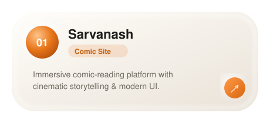
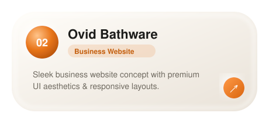
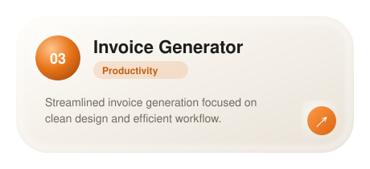
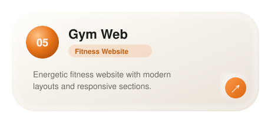
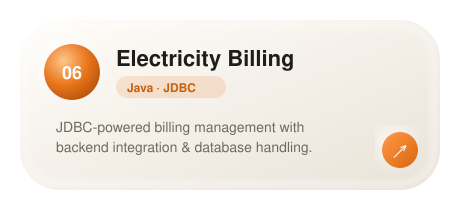
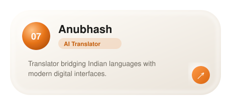

**Immersive digital experiences, futuristic interfaces and interactive systems — where creativity meets code.**

---

## 🌌 About Me

Hey there! I'm **Saransh Chaudhary** — a passionate developer and creative designer focused on building visually immersive and cinematic digital experiences.

I love combining:

* ⚡ Creative Development
* 🎬 Motion Design & Video Editing
* 🖥️ Futuristic UI/UX
* 🎮 Interactive Systems
* 🚗 Simulator & OS Concepts
* 🎨 Comic & Visual Storytelling

Currently exploring:

* **Three.js & React Three Fiber**
* **Cinematic Web Experiences**
* **Interactive 3D Interfaces**
* **Advanced UI Animation Systems**
* **Creative Developer Tooling**

---

## ⚒️ Tech Arsenal

---

## 🚀 Featured Projects

<table>
<tr>
<td></td>
<td></td>
</tr>
<tr>
<td></td>
<td></td>
</tr>
<tr>
<td></td>
<td></td>
</tr>
<tr>
<td colspan="2" align="center"></td>
</tr>
</table>

---

## 🔥 Contribution Streak

---

## 🌐 Connect With Me

